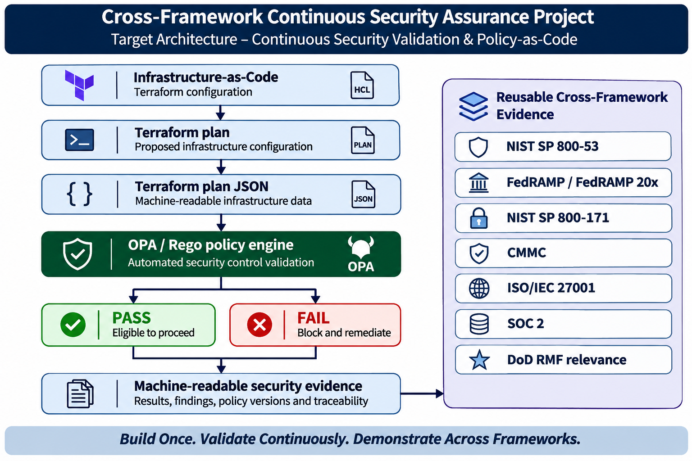

# Cross-Framework Continuous Security Assurance Project (Still In Progress)

## Automating Security Validation & Reusable Compliance Evidence

### Build Once. Validate Continuously. Demonstrate Across Frameworks.

An AWS-based security engineering and compliance portfolio project exploring how Infrastructure-as-Code (IaC), Policy-as-Code (PaC), and automated evidence collection can bridge the gap between technical security implementation and security assessment.

## The Business Problem

Organizations supporting multiple security and compliance frameworks often face overlapping technical requirements, repetitive control validation, fragmented evidence, and manual assessment preparation. Point-in-time reviews alone can also leave gaps between an assessed configuration and subsequent changes.

This project explores a practical alternative: define security requirements in code, automatically evaluate proposed infrastructure changes, and generate traceable evidence that can be reused wherever framework requirements genuinely overlap.

| Business challenge | Engineering approach | Intended benefit |
| --- | --- | --- |
| Inconsistent security configurations | Secure Terraform baselines and policy checks | Repeatable, reviewable security requirements |
| Manual security validation | OPA/Rego and planned CI/CD gates | Earlier detection of insecure changes |
| Fragmented assessment evidence | Machine-readable results and version-controlled artifacts | More traceable, repeatable evidence collection |
| Overlapping compliance requirements | Cross-framework control and evidence mapping | Reduced duplication where evidence is applicable |

## Target Architecture

The target workflow evaluates Terraform plan JSON against security policies, produces a pass/fail decision, and retains machine-readable findings for review and cross-framework mapping. Failed checks are intended to block progression at a future automated gate until remediated; a passing check indicates only that the evaluated requirements are satisfied.

### Implemented and verified: AWS security baseline

| Security capability | Technical implementation |
| --- | --- |
| Network isolation | VPC `10.30.0.0/16`; two private subnets (`10.30.10.0/24`, `10.30.20.0/24`); local-only routing; no internet or NAT gateway |
| Default-deny connectivity | Workload security group with no inbound or outbound rules |
| Least-privilege identity foundation | EC2-only IAM trust; no attached managed or inline permissions; exclusive empty policy sets managed by Terraform; instance profile |
| Private workload | Amazon Linux 2023 on `t3a.micro`; no public IPv4, SSH key, or user data |
| Metadata security | IMDSv2 required |
| Storage protection | Encrypted 8 GiB gp3 root EBS volume with delete-on-termination enabled |
| Cost-aware configuration | Standard CPU credits; temporary workload and root volume removed after verification |

### Security Engineering Principles

- Default-deny network access, with connectivity explicitly authorized based on documented workload requirements.
- Least-privilege workload identity, with permissions introduced only when justified by documented workload requirements.
- Public IPv4 assignment disabled for the EC2 workload.
- IMDSv2 required.
- Root EBS encryption enabled.
- Root volume delete-on-termination enabled.
- Standard CPU credits for T3/T3a instances (a cost-governance requirement rather than a direct security control).

The planned baseline includes a pinned OPA release, Rego policy checks, positive and negative tests, and machine-readable results. Missing or indeterminate required attributes will be handled explicitly rather than silently accepted. These capabilities are not yet claimed as implemented.

## Cross-Framework Security Assurance

The project's primary technical anchors are NIST SP 800-53 and FedRAMP. Secondary mappings are intended to demonstrate evidence reuse without treating different frameworks as interchangeable.

| Framework or assessment context | Intended role |
| --- | --- |
| NIST SP 800-53 | Primary security control anchor |
| FedRAMP | Traditional Moderate baseline alignment |
| FedRAMP 20x | Applicable Key Security Indicators (KSIs) and automated assurance concepts |
| NIST SP 800-171 | Relevant CUI protection requirement traceability |
| CMMC Level 2 | Relevant assessment requirement traceability |
| ISO/IEC 27001 | Relevant information security control and ISMS context |
| SOC 2 | Relevant Trust Services Criteria context |
| DoD RMF | Relevance to control implementation, assessment evidence, and continuous monitoring |

The intended mapping approach connects a technical requirement to its implementation, validation result, evidence artifact, and applicable framework requirements. Each mapping must be evaluated for scope, applicability, and sufficiency. A single technical artifact may support multiple requirements, but does not automatically satisfy them in full.

## Evidence and Engineering Governance

Security assurance is treated as an engineering deliverable, not an afterthought. Each meaningful milestone begins with an evidence plan and ends with a documented evidence closure review.

- **Evidence planning:** Define artifact names, locations, and expected proof before implementation.
- **Validation:** Retain applicable pre-change, execution, post-change, security-specific, and convergence evidence.
- **Traceability:** Use version control and an evidence inventory to connect implementation decisions to artifacts.
- **Sanitization:** Review public artifacts for credentials, account identifiers, and other unnecessary sensitive information. Raw Terraform plans and state are not intended for public release.
- **Closure:** Reconcile evidence, review applicable categories, and verify Git synchronization before advancing milestones.

Explore the [project evidence](evidence/) and [Phase 3 target architecture design artifact](evidence/phase-3/screenshots/phase-3-target-architecture.png).

## Technology Stack

| Technology | Role | Status |
| --- | --- | --- |
| AWS (VPC, EC2, IAM, EBS) | Cloud infrastructure and workload security | Baseline implemented and verified |
| Terraform (HCL) | Declarative infrastructure and repeatable configuration | In use |
| Git / GitHub | Version control, traceability, and portfolio publication | In use |
| VS Code / PowerShell / GitHub CLI | Local engineering and repository workflow | Development environment |
| OPA / Rego | Policy-as-Code evaluation of Terraform plan JSON | Phase 3 in progress |
| GitHub Actions | Automated policy testing and security gates | Planned |
| Machine-readable evidence and control mapping | Reusable security assurance artifacts | Planned automation and mapping |

## Explore the Repository

| Location | Purpose |
| --- | --- |
| [`terraform/`](terraform/) | Infrastructure configuration |
| [`policies/`](policies/) | Policy-as-Code development area |
| [`evidence/`](evidence/) | Milestone evidence and verification artifacts |

For a technical walkthrough, start with the Terraform configuration and Phase 2 evidence, then follow Phase 3 as policy validation and evidence automation are introduced. Git history provides additional context for implementation decisions and milestone progression.

## Why This Project Matters

This portfolio connects hands-on cloud infrastructure engineering with the work of security assessors, GRC practitioners, and authorization teams. It demonstrates secure-by-default design, disciplined change management, evidence planning, and cost-aware cloud operations, while developing the automation needed to make security validation more repeatable and assessment evidence more reusable.

The goal is not to build separate compliance environments for every framework or replace assessor judgment. It is to explore how a common technical security foundation can support multiple assessment needs with less duplicated work.

---

> **Scope and disclaimer:** This is a personal training and portfolio project, not a production system, formal assessment package, FedRAMP authorization, CMMC certification, ISO/IEC 27001 certification, or SOC 2 attestation. Planned capabilities are distinguished from implemented and verified work. Framework mappings and automated checks support, but do not independently establish, compliance or authorization.
